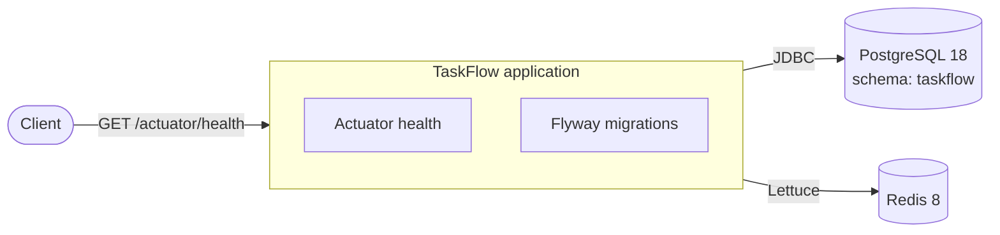
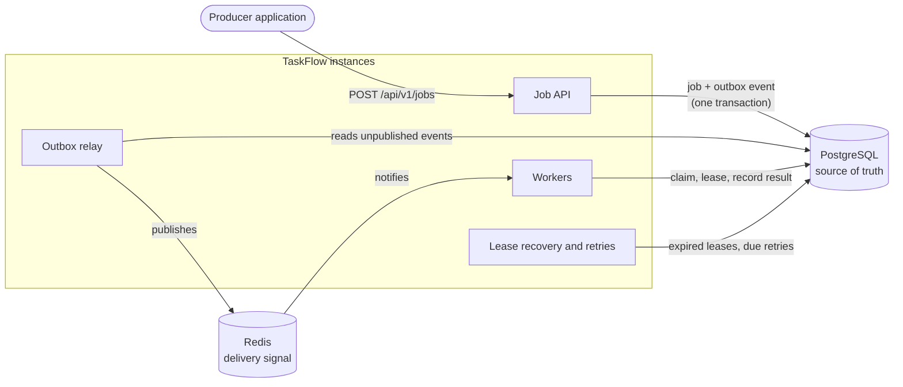

# Architecture

TaskFlow lets applications submit background jobs for asynchronous execution. It persists each job, hands it to a worker, tracks its lifecycle, and retries failures.

This document separates **what exists today** from **what is planned**. Planned parts are marked as such and may change as milestones are designed. The reasoning behind individual choices is in [design-decisions.md](design-decisions.md).

## Current state (M0)

The foundation is in place; no job processing exists yet.

| Component | Status | Role today |
|---|---|---|
| Spring Boot application | ✅ | Starts, validates required configuration, exposes `/actuator/health` |
| PostgreSQL | ✅ | Connected; Flyway manages the `taskflow` schema (no tables yet) |
| Redis | ✅ | Connected and health-checked; not used for processing yet |
| Docker Compose | ✅ | Runs PostgreSQL and Redis locally on `127.0.0.1` |
| CI | ✅ | GitHub Actions runs unit and integration tests on every push |

## Target architecture (planned)

A modular monolith: one application, deployed as several instances. Some instances serve the API; others run as workers. Workers are the same codebase started in a worker role, so "distributed" means many cooperating instances, not many services.

### Responsibilities

| Component | Responsibility | Milestone |
|---|---|---|
| Job API | Validates submissions, stores jobs, exposes status and history | M1 |
| Job lifecycle | Defines the states and the only allowed transitions between them | M1 |
| Workers | Claim jobs, run the matching handler, record the outcome | M2 |
| Lease recovery | Returns jobs abandoned by crashed workers to the queue | M3 |
| Retry policy | Reschedules failed jobs with backoff; gives up after the limit | M3 |
| Outbox relay | Publishes committed jobs to Redis; retries until delivered | M4 |
| Redis | Speeds up delivery; never the only copy of a job | M4 |
| Scheduler | Releases delayed and scheduled jobs when they are due | M5 |
| Observability | Metrics, structured logs, dashboards | M6 |

### Job flow (planned)

1. **Submit.** A producer sends a job. TaskFlow validates it and, in one database transaction, stores the job and an outbox event. The job ID is returned only after that transaction commits.
2. **Publish.** The outbox relay sends committed events to Redis. If Redis is unavailable, the events stay in PostgreSQL and are retried, so no job is lost.
3. **Claim.** A worker claims the job in PostgreSQL with a time-limited lease. Row locking (`FOR UPDATE SKIP LOCKED`) guarantees that two workers cannot claim the same job.
4. **Execute.** The worker runs the job's handler and renews its lease while working.
5. **Complete.** The worker records the outcome, and the attempt is added to the job's history.
6. **Fail and retry.** A failed attempt is rescheduled with backoff until the retry limit is reached; then the job ends in a terminal failed state for investigation.
7. **Recover.** If a worker crashes, its lease expires and the job becomes claimable again.

**Delivery guarantee:** at-least-once. A job can run more than once (for example, if a worker crashes after the side effect but before recording completion), so handlers must be safe to retry. Exactly-once execution is not claimed.

The exact set of job states is designed at the start of M1. Principles already agreed:
- Job state is separate from delivery state: whether an event reached Redis is tracked in the outbox, not on the job.
- "Waiting for a retry" and "waiting for a scheduled time" share one waiting state plus a `run_at` time.
- There is a single terminal failure state.

## Roadmap

Progress and target dates are tracked in the repository's [GitHub milestones](https://github.com/Aayaman/taskflow/milestones).

| Milestone | Goal |
|---|---|
| ✅ **M0: Project foundation** | Reproducible environment: application, PostgreSQL, Redis, configuration, tests, CI |
| **M1: Job submission & persistence** | Submit, store and retrieve jobs through a validated REST API with idempotent submission |
| **M2: PostgreSQL-only queue & workers** | Several workers process jobs concurrently, and no job is ever claimed twice |
| **M3: Reliability & recovery** | Retries with backoff, leases, crash recovery, dead-lettering and attempt history |
| **M4: Redis via transactional outbox** | Faster delivery through Redis without risking lost or invisible jobs |
| **M5: Advanced queue features** | Priorities without starvation, scheduled jobs, cancellation, filtering and pagination |
| **M6: Observability** | Understand throughput, latency, failures and worker health without reading code |
| **M7: Testing & performance** | Reproducible load tests and failure-injection results; measure what Redis adds over PostgreSQL alone |
| **M8: Deployment** | A documented, reproducible cloud deployment |
| **M9: Polish** | Documentation and demo that let another developer understand and run the platform |

### Why PostgreSQL-only before Redis

The queue is built on PostgreSQL first (M2, M3) and Redis is added afterwards (M4).

- **Correctness first.** Safe claiming, leases and retries are easiest to get right inside a single transactional database. Adding Redis first would mean coordinating two systems before either is understood.
- **No throwaway work.** Publishing directly to Redis without an outbox has the dual-write problem (a job saved in PostgreSQL may never reach Redis). Building it that way first would mean rewriting it in M4.
- **Measured, not assumed.** With a working PostgreSQL-only queue as the baseline, M7 can measure what Redis actually improves, rather than assuming it is needed.
